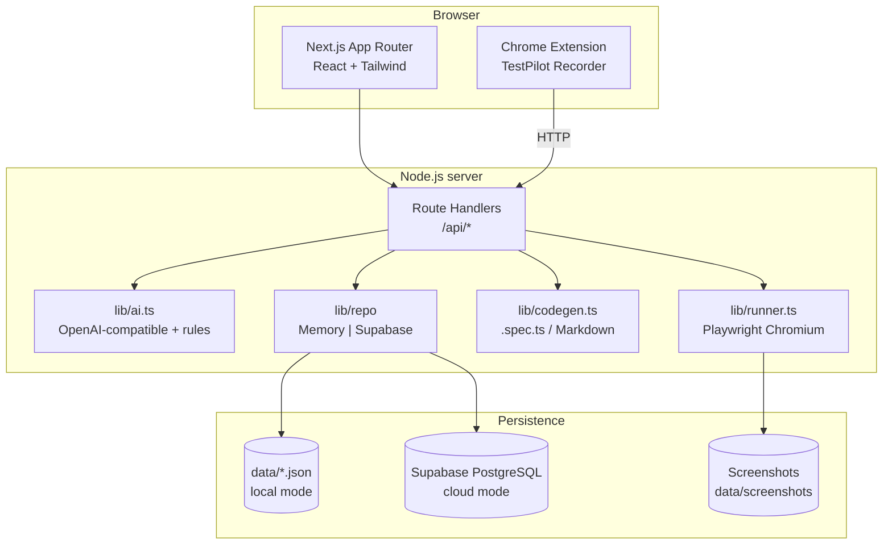
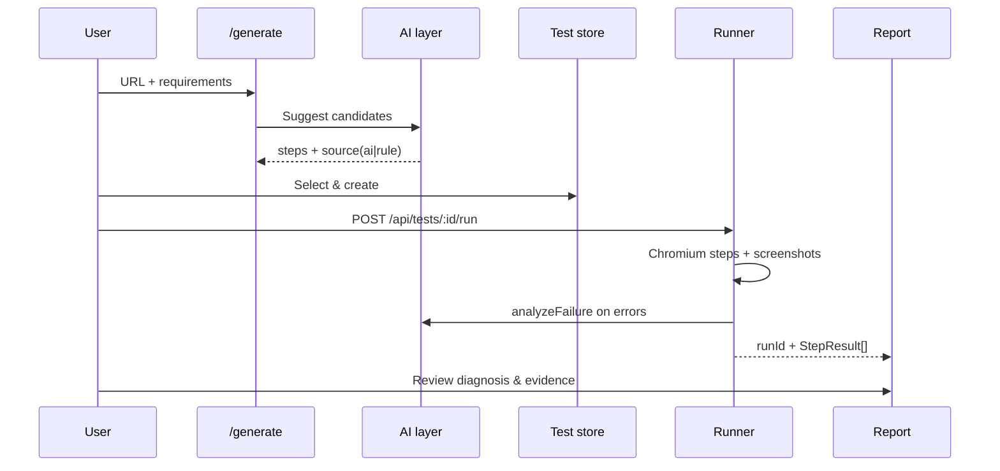

<div align="center">

# ✦ TestPilot AI

### Describe what to test in natural language — get runnable Playwright tests in minutes

**AI Test Development Assistant** · Generate · Run · Capture · Diagnose · Export  
A web automation workbench for small teams and indie developers

[](https://github.com/yimaomao-max/testpilot-ai)
[](https://nextjs.org/)
[](https://www.typescriptlang.org/)
[](https://playwright.dev/)
[](LICENSE)

**Languages:** [中文](README.md) | [English](README.en.md)

[Quick start](#-quick-start) · [Features](#-features) · [Architecture](#-architecture) · [Docs](#-documentation) · [Roadmap](#-roadmap)

</div>

---

## 🎯 What is this?

**TestPilot AI** turns test authoring from hand-written scripts into a repeatable pipeline:

| Stage | You | TestPilot |
|-------|-----|-----------|
| **Define** | Target URL + scenario in natural language | AI (or rule fallback) produces steps and candidate cases |
| **Review** | Select, edit, refine steps | Persist cases with optional project / requirement traceability |
| **Run** | One-click execute | Server-side Playwright (Chromium), step-by-step with screenshots |
| **Diagnose** | Open the report | Failed steps grouped + AI root-cause hints |
| **Deliver** | Download or copy | Export standalone `.spec.ts` and Markdown reports |

> **Design principle:** With no AI key configured, the full path still works (rule mode) so demos, local dev, and CI are never blocked.

---

## ✨ Features

### Core

- 🤖 **Smart case generation** — URL smoke flows / wizard with multiple candidates (OpenAI-compatible API)
- 🧪 **Playwright runner** — Headless Chromium, per-step timeouts, fail-fast with preserved evidence
- 📸 **Evidence trail** — Screenshot per step; lightbox in reports
- 🔁 **Selector healing** — Primary `selector` + `selectorCandidates` fallback chain (recorder-friendly)
- 🧠 **Failure analysis** — AI diagnosis + rule fallback; suggested next steps
- 📦 **Export** — TypeScript tests and Markdown reports via `codegen.ts`
- 🧭 **Dashboard** — Pass-rate donut, status breakdown, 14-day trend, case overview
- 🔌 **Chrome recorder** — Manifest V3 extension pushing cases to your local API
- ☁️ **Dual storage** — Local JSON by default; Supabase PostgreSQL + auth when configured

### Pages

| Page | Route | Highlights |
|------|-------|------------|
| Dashboard | `/` | Pass rate, distribution, trends, shortcuts |
| Case wizard | `/generate` | 3 steps: requirements → review → batch create |
| Case list | `/tests` | Browse and manage |
| Case detail | `/tests/[id]` | Edit steps, run, open report |
| Code view | `/tests/[id]/code` | Runnable Playwright source |
| Report | `/reports/[runId]` | Dark UI, failures, AI notes, screenshots |
| Login | `/login` | Supabase cloud mode |

Step-by-step walkthrough: **[User guide](docs/USER_GUIDE.en.md)** ([中文](docs/USER_GUIDE.md)).

---

## 🏗 Architecture



### End-to-end flow



---

## 🛠 Stack

| Layer | Choice | Notes |
|-------|--------|-------|
| Web | Next.js 14 App Router | RSC + client components, API in-repo |
| Language | TypeScript 5.6 | End-to-end typing |
| UI | Tailwind CSS 3.4 | Dashboard & report visuals |
| Runner | Playwright 1.62 | `postinstall` installs Chromium |
| AI | OpenAI-compatible chat | OpenAI, proxies, or private gateways |
| Storage | JSON **or** Supabase | `getRepo()` switches on env vars |
| Extension | Chrome MV3 | Load `extension/` unpacked |

---

## 🚀 Quick start

### Requirements

- **Node.js** ≥ 18
- **npm** ≥ 9 (or pnpm / yarn)
- Optional: **OpenAI-compatible API key** (rule mode if omitted)
- Optional: **Supabase project** for multi-user cloud persistence

### Install

```bash
git clone https://github.com/yimaomao-max/testpilot-ai.git
cd testpilot-ai
npm install          # runs playwright install chromium
cp .env.example .env.local
npm run dev          # http://localhost:3000
```

Production:

```bash
npm run build
npm start
```

### AI (optional)

```env
OPENAI_API_KEY=sk-...
OPENAI_BASE_URL=https://api.openai.com/v1
OPENAI_MODEL=gpt-4o-mini
```

Check `GET /api/status` → `{ "aiEnabled": true }`.

### Supabase (optional)

```env
NEXT_PUBLIC_SUPABASE_URL=https://xxx.supabase.co
NEXT_PUBLIC_SUPABASE_ANON_KEY=eyJ...
SUPABASE_SERVICE_ROLE_KEY=eyJ...
```

Run `supabase/migrations/0001_init.sql`. Without these vars, **local JSON mode** is used automatically.

### Chrome recorder

1. `chrome://extensions` → Developer mode
2. Load unpacked → select **`extension/`**
3. Extension calls **`http://localhost:3100`** (not the default dev port 3000):

   ```bash
   npm run dev -- -p 3100
   ```

4. Record → pick project/requirement → create case

---

## 📡 API overview

| Method | Path | Purpose |
|--------|------|---------|
| `GET` | `/api/status` | AI availability |
| `GET` | `/api/stats` | Dashboard metrics |
| `GET/POST` | `/api/tests` | List / create (with AI) |
| `GET/PUT/DELETE` | `/api/tests/[id]` | CRUD + steps |
| `POST` | `/api/tests/[id]/run` | Run Playwright |
| `GET` | `/api/tests/[id]/export` | Code or Markdown |
| `POST` | `/api/generate` | Wizard candidates |
| `GET` | `/api/runs/[runId]` | Run detail |
| `GET` | `/api/screenshots/[runId]/[file]` | Screenshot asset |
| `GET/POST` | `/api/projects` | Projects (traceability) |
| `GET/POST` | `/api/requirements` | Requirements |
| `GET` | `/api/projects/[id]/traceability` | Trace view |
| `GET` | `/api/auth/status` | Auth state |

Details: **[API reference](docs/API_REFERENCE.en.md)** ([中文](docs/API_REFERENCE.md)).

---

## 📂 Repository layout

```
testpilot-ai/
├── src/app/          # Pages + API routes
├── src/lib/          # ai, runner, codegen, repo, storage
├── extension/        # Chrome recorder
├── supabase/migrations/
├── docs/
└── package.json
```

Runtime data lives under **`data/`** (gitignored).

---

## 🧩 Step types

| type | Meaning |
|------|---------|
| `goto` | Navigate (URL on case or `step.value`) |
| `click` | Click element |
| `fill` | Type text |
| `press` | Key press |
| `select` | Dropdown |
| `waitForSelector` | Wait for element |
| `expectText` | Assert text |
| `expectVisible` | Assert visible |
| `wait` | Fixed delay (ms) |
| `screenshot` | Capture screenshot |

---

## 📚 Documentation

| Doc | Description |
|-----|-------------|
| [User guide (EN)](docs/USER_GUIDE.en.md) · [中文](docs/USER_GUIDE.md) | Install → first green run |
| [API reference (EN)](docs/API_REFERENCE.en.md) · [中文](docs/API_REFERENCE.md) | REST endpoints |
| [PRD MVP](docs/01-PRD-MVP.md) | Product spec (Chinese) |
| [Architecture](docs/02-技术架构与数据库设计.md) | Evolution & DB (Chinese) |

---

## 🗺 Roadmap

- [x] MVP: AI/rule generate, run, report, export
- [x] Project / requirement / traceability APIs
- [x] Supabase repo + migrations
- [x] Chrome recorder (local)
- [ ] Local Runner CLI
- [ ] Scheduled runs & webhooks
- [ ] CI / GitHub PR integration & usage billing

---

## 🤝 Contributing

Open [Issues](https://github.com/yimaomao-max/testpilot-ai/issues) for bugs and ideas.

```bash
git checkout -b feat/your-feature
npm run build
git commit -m "feat: ..."
git push origin feat/your-feature
```

---

## 📄 License

[MIT License](LICENSE)

---

<div align="center">

**If TestPilot AI saves you time writing tests, consider starring the repo ⭐**

[github.com/yimaomao-max/testpilot-ai](https://github.com/yimaomao-max/testpilot-ai)

</div>