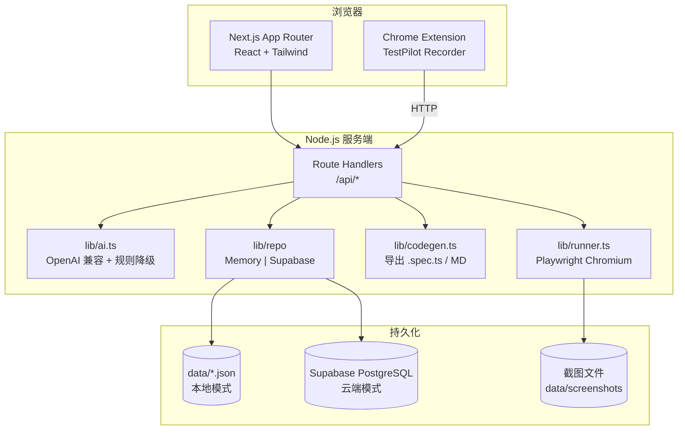
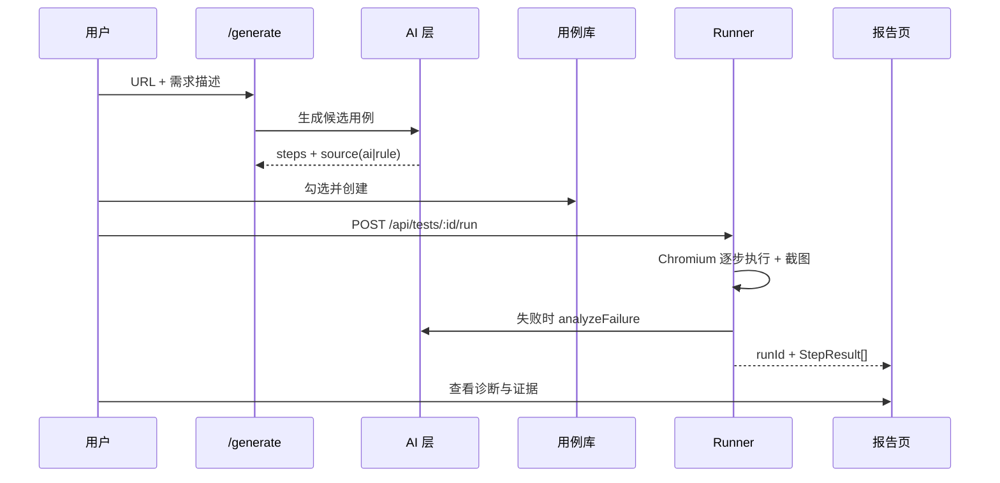

<div align="center">

# ✦ TestPilot AI

### 用自然语言描述需求，分钟级获得可运行的 Playwright 测试

**AI 测试开发助手** · 生成 · 执行 · 截图 · 诊断 · 导出  
面向小团队与独立开发者的 Web 自动化测试工作台

[](https://github.com/yimaomao-max/testpilot-ai)
[](https://nextjs.org/)
[](https://www.typescriptlang.org/)
[](https://playwright.dev/)
[](LICENSE)

**语言 · Languages:** [中文](README.md) | [English](README.en.md)

[快速开始](#-快速开始) · [功能一览](#-功能一览) · [架构](#-系统架构) · [文档](#-文档导航) · [路线图](#-路线图)

</div>

---

## 🎯 这是什么？

**TestPilot AI** 把「写自动化测试」从繁重的脚本工程，变成一条可复制的智能流水线：

| 阶段 | 你做什么 | TestPilot 做什么 |
|------|----------|------------------|
| **定义** | 输入目标 URL + 用自然语言描述场景 | AI（或规则降级）生成结构化步骤与候选用例 |
| **评审** | 勾选、编辑、补充步骤 | 保存用例，支持项目 / 需求追溯字段 |
| **执行** | 一键运行 | 服务端 Playwright（Chromium）逐步执行并截图 |
| **诊断** | 查看报告 | 失败步骤分组 + AI 根因分析与修复建议 |
| **交付** | 下载或复制 | 导出可独立运行的 `.spec.ts` 与 Markdown 报告 |

> **设计信条**：未配置任何 AI Key 时，全链路仍可走通（规则模式），保证 Demo、开发与 CI 不被阻塞。

---

## ✨ 功能一览

### 核心能力

- 🤖 **智能用例生成** — URL 冒烟步骤 / 需求向导批量生成多组候选用例（OpenAI 兼容 API）
- 🧪 **Playwright 执行引擎** — 无头 Chromium、逐步超时、失败即停并保留现场
- 📸 **证据链** — 每步自动截图；报告页支持放大查看
- 🔁 **选择器自愈** — 主选择器 + `selectorCandidates` 候选链，适配录制插件场景
- 🧠 **失败分析 A3** — AI 诊断 + 规则降级；输出建议下一步
- 📦 **代码与报告导出** — `codegen.ts` 生成 TypeScript 测试文件与可读报告
- 🧭 **工作台仪表盘** — 通过率环图、状态分布、近 14 天趋势、用例速览
- 🔌 **Chrome 录制插件** — Manifest V3，操作录制后推送至本地 API 创建用例
- ☁️ **双模存储** — 默认本地 JSON；配置 Supabase 后切换 PostgreSQL + 登录

### 产品页面

| 页面 | 路由 | 体验要点 |
|------|------|----------|
| 总览仪表盘 | `/` | 通过率环形图、用例状态条、趋势、快捷入口 |
| 用例生成器 | `/generate` | 三步向导：需求 → 评审勾选 → 批量创建 |
| 用例列表 | `/tests` | 筛选与管理 |
| 用例详情 | `/tests/[id]` | 步骤编辑、运行、跳转报告 |
| 代码视图 | `/tests/[id]/code` | 高亮展示可运行 Playwright 代码 |
| 测试报告 | `/reports/[runId]` | 深色主题、失败聚类、AI 分析、截图 |
| 登录 | `/login` | Supabase 云端模式 |

更细的逐步说明见 **[用户使用指南](docs/USER_GUIDE.md)**（[English](docs/USER_GUIDE.en.md)）。

---

## 🏗 系统架构



### 端到端数据流



---

## 🛠 技术栈

| 层级 | 选型 | 说明 |
|------|------|------|
| 前端框架 | Next.js 14 App Router | RSC + Client 混合，API 同仓 |
| 语言 | TypeScript 5.6 | 端到端类型安全 |
| 样式 | Tailwind CSS 3.4 | 仪表盘与报告页深色/数据可视化 UI |
| 执行 | Playwright 1.62 | `postinstall` 自动安装 Chromium |
| AI | OpenAI 兼容 Chat Completions | 可接 OpenAI / 国内中转 / 私有网关 |
| 存储 | JSON 文件 **或** Supabase | `getRepo()` 工厂按环境变量切换 |
| 插件 | Chrome MV3 | `extension/` 独立加载 |

---

## 🚀 快速开始

### 环境要求

- **Node.js** ≥ 18
- **npm** ≥ 9（或 pnpm / yarn）
- 可选：**OpenAI 兼容 API Key**（不配置则规则模式）
- 可选：**Supabase 项目**（多用户与云端持久化）

### 安装与启动

```bash
git clone https://github.com/yimaomao-max/testpilot-ai.git
cd testpilot-ai
npm install          # 自动 playwright install chromium
cp .env.example .env.local
npm run dev          # http://localhost:3000
```

生产构建：

```bash
npm run build
npm start
```

### AI 配置（可选）

在 `.env.local` 中填入任意 **OpenAI 兼容** 端点：

```env
OPENAI_API_KEY=sk-...
OPENAI_BASE_URL=https://api.openai.com/v1
OPENAI_MODEL=gpt-4o-mini
```

启动后访问 `GET /api/status` 可确认 `{ "aiEnabled": true }`。

### Supabase 云端模式（可选）

```env
NEXT_PUBLIC_SUPABASE_URL=https://xxx.supabase.co
NEXT_PUBLIC_SUPABASE_ANON_KEY=eyJ...
SUPABASE_SERVICE_ROLE_KEY=eyJ...
```

执行 `supabase/migrations/0001_init.sql` 初始化表结构。未配置时自动使用 **本地 JSON 模式**（零依赖数据库）。

### Chrome 录制插件

1. 打开 `chrome://extensions` → 开启「开发者模式」
2. 「加载已解压的扩展程序」→ 选择仓库内 **`extension/`** 目录
3. 本地 API 默认对接 **`http://localhost:3100`**（与 `npm run dev` 的 3000 端口不同）

   ```bash
   npm run dev -- -p 3100
   ```

4. 在目标页面录制操作 → 在弹窗中选择项目/需求 → 一键创建用例

---

## 📡 API 概览

| 方法 | 路径 | 用途 |
|------|------|------|
| `GET` | `/api/status` | AI 是否可用 |
| `GET` | `/api/stats` | 仪表盘统计数据 |
| `GET/POST` | `/api/tests` | 列表 / 创建（含 AI 生成） |
| `GET/PUT/DELETE` | `/api/tests/[id]` | 详情 / 更新步骤 / 删除 |
| `POST` | `/api/tests/[id]/run` | 触发 Playwright 执行 |
| `GET` | `/api/tests/[id]/export` | 导出代码或 Markdown 报告 |
| `POST` | `/api/generate` | 生成向导：候选用例 |
| `GET` | `/api/runs/[runId]` | 单次运行结果 |
| `GET` | `/api/screenshots/[runId]/[file]` | 截图静态资源 |
| `GET/POST` | `/api/projects` | 项目 CRUD（追溯链） |
| `GET/POST` | `/api/requirements` | 需求 CRUD |
| `GET` | `/api/projects/[id]/traceability` | 需求–用例–执行追溯 |
| `GET` | `/api/auth/status` | 认证状态 |

完整参数与响应示例见 **[API 参考](docs/API_REFERENCE.md)**（[English](docs/API_REFERENCE.en.md)）。

---

## 📂 仓库结构

```
testpilot-ai/
├── src/
│   ├── app/                    # 页面 + Route Handlers
│   │   ├── page.tsx            # 仪表盘
│   │   ├── generate/           # 三步用例生成器
│   │   ├── tests/              # 列表 / 详情 / 代码
│   │   ├── reports/            # 执行报告
│   │   └── api/                # REST API
│   ├── components/             # Nav 等 UI
│   └── lib/
│       ├── ai.ts               # 生成 + 失败分析 + 降级
│       ├── runner.ts           # Playwright 执行
│       ├── codegen.ts          # 导出
│       ├── storage.ts          # JSON 文件 IO
│       └── repo/                 # MemoryRepo | SupabaseRepo
├── extension/                  # Chrome 录制插件
├── supabase/migrations/        # 云端 DDL
├── docs/                       # PRD、架构、用户指南
├── .env.example
└── package.json
```

本地运行时数据写入 **`data/`**（已在 `.gitignore` 中排除，不会进入 Git）。

---

## 🧩 支持的步骤类型

| type | 含义 |
|------|------|
| `goto` | 导航（URL 在用例级 `url` 或 step.value） |
| `click` | 点击元素 |
| `fill` | 输入文本 |
| `press` | 键盘按键 |
| `select` | 下拉选择 |
| `waitForSelector` | 等待元素出现 |
| `expectText` | 断言文本 |
| `expectVisible` | 断言可见 |
| `wait` | 固定等待（毫秒） |
| `screenshot` | 截图步骤 |

---

## 📚 文档导航

| 文档 | 内容 |
|------|------|
| [用户使用指南](docs/USER_GUIDE.md) · [EN](docs/USER_GUIDE.en.md) | 从安装到第一次跑通的全流程 |
| [API 参考](docs/API_REFERENCE.md) · [EN](docs/API_REFERENCE.en.md) | 主要 REST 端点说明 |
| [PRD MVP](docs/01-PRD-MVP.md) | 产品需求与页面规格 |
| [技术架构](docs/02-技术架构与数据库设计.md) | 演进路径与 Supabase 模型 |
| [开发任务拆解](docs/03-开发任务拆解.md) | 迭代计划 |

---

## 🗺 路线图

- [x] MVP：AI/规则生成、执行、报告、导出
- [x] 项目 / 需求 / 追溯 API（Phase 1）
- [x] Supabase 仓库实现与迁移脚本
- [x] Chrome 录制插件（本地联调）
- [ ] Local Runner CLI（本地规模化执行 + 上报）
- [ ] 定时回归与 Webhook 通知
- [ ] CI/GitHub PR 集成与额度计费

---

## 🤝 贡献与反馈

欢迎通过 [Issues](https://github.com/yimaomao-max/testpilot-ai/issues) 提交 Bug、功能建议或使用场景。

```bash
# 典型贡献流程
git checkout -b feat/your-feature
npm run build    # 确保构建通过
git commit -m "feat: ..."
git push origin feat/your-feature
```

---

## 📄 许可

本项目采用 [MIT License](LICENSE) 开源。

---

<div align="center">

**如果 TestPilot AI 帮你节省了写测试的时间，欢迎 Star ⭐**

[github.com/yimaomao-max/testpilot-ai](https://github.com/yimaomao-max/testpilot-ai)

</div>